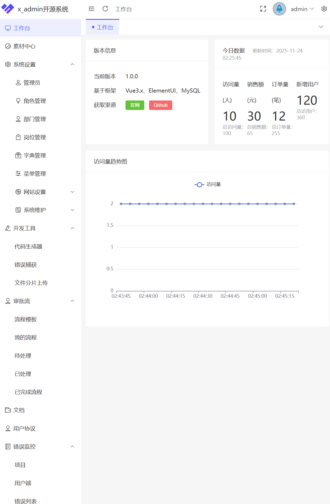
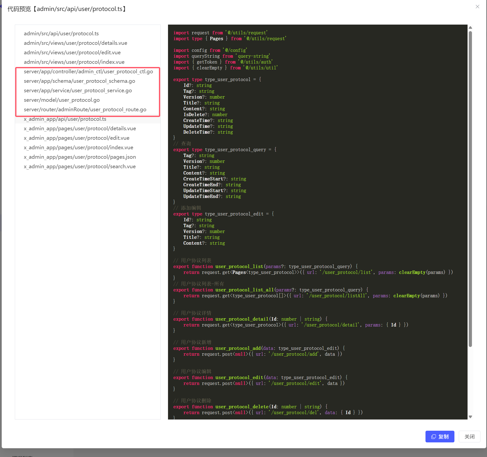
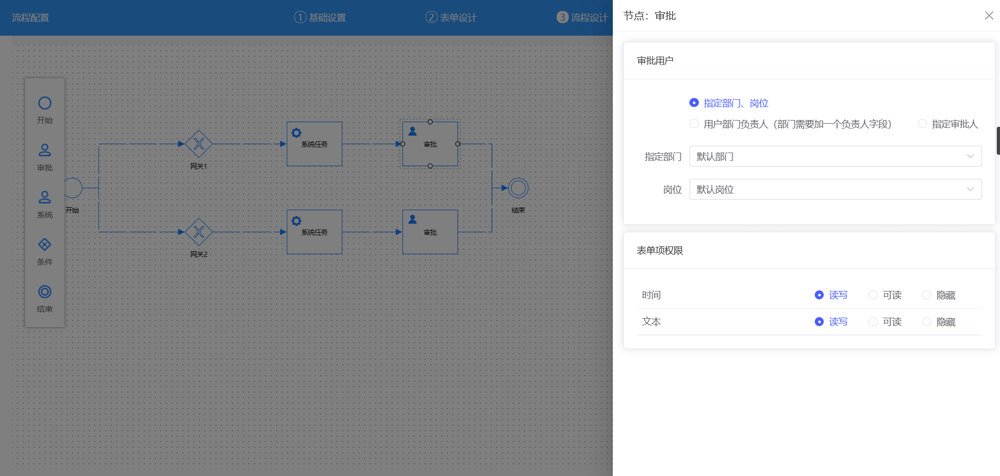
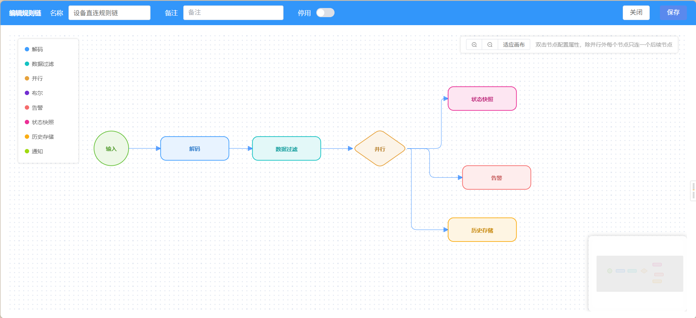
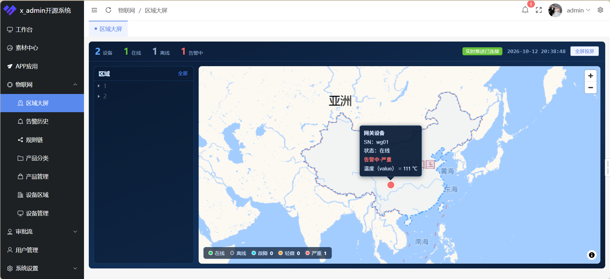
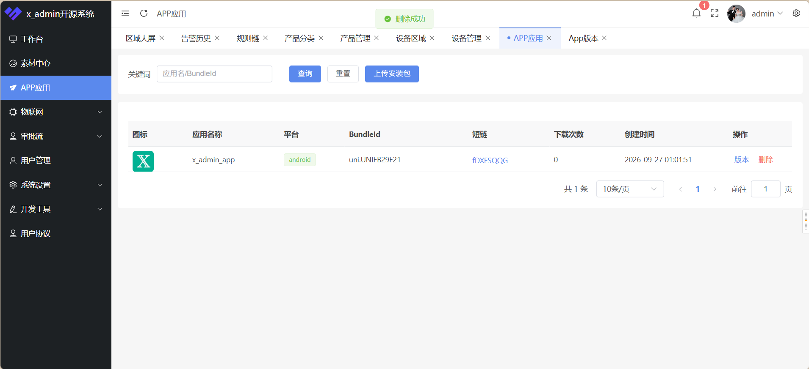
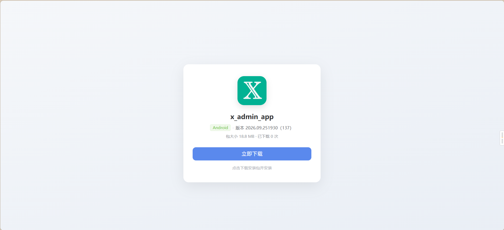
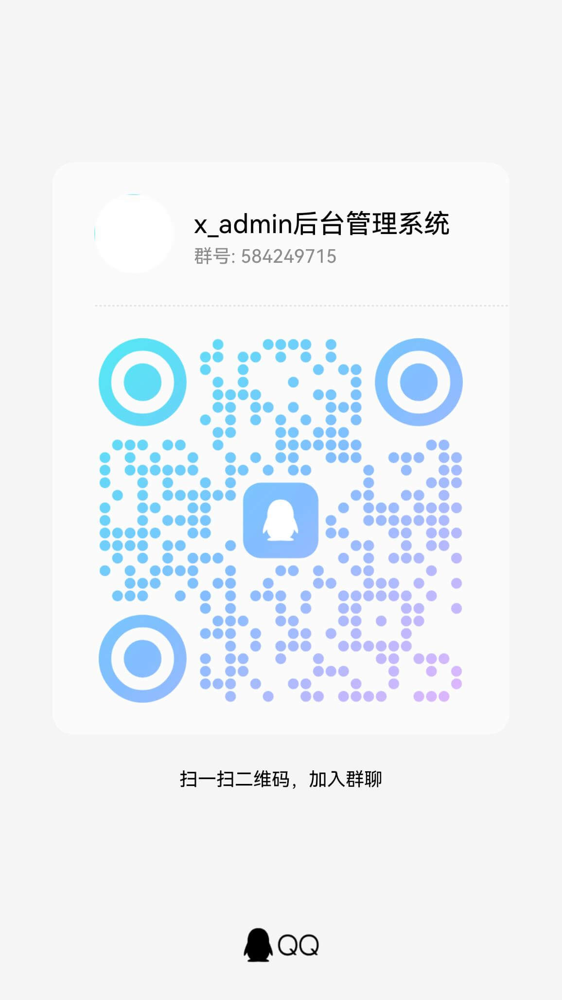

<h2 align="center">x_admin通用管理后台（GoLang、gin）(vue3、element-plus)</h2>

        
 
<h6 align="center">本仓库基于：<a href="https://gitee.com/likeadmin/likeadmin_go">https://gitee.com/likeadmin/likeadmin_go</a><h6>

  

## 体验 

本仓库演示地址：http://x.adtk.cn  
账号：x@qq.com 密码：123456
    
## 文档
- 开发部署文档：https://x.adtk.cn/x_admin/
- 文档源码 : /docs

## 简介

x_admin 是一套免费开源、前后端分离的通用管理后台，遵循 MIT 协议。后端基于 **Go + Gin + GORM + Redis**，未使用 cgo，可跨平台单文件打包、无需运行环境，部署轻量；前端基于 **Vue3 + Vite + TypeScript + Element Plus**，移动端为 **uni-app x**。

除常规权限管理外，内置 **代码生成器**（一键生成前端/后端/App CRUD 代码）、**可视化审批流**、**IoT 物联网**（设备接入 + 可视化规则链 + 告警状态机 + 区域大屏实时推送）与 **APP 发布热更新** 等能力，适用于管理后台、物联网平台等快速开发场景。

### 项目结构

| 目录 | 说明 |
|------|------|
| `server/` | Go 后端服务（Gin/GORM/Redis，含 IoT、发布、队列、定时任务、WebSocket） |
| `admin/` | Vue3 + Element Plus 管理后台前端 |
| `x_admin_app/` | uni-app 移动端 App |
| `docs/` | VitePress 开发部署文档站 |
| `x_err_sdk/` | 错误上报 SDK（web / uni / react-native） |

## 进一步了解
### 能力总览

- **系统管理**：工作台、菜单权限控制、角色、管理员、部门管理、岗位管理
- **内容/配置**：素材管理、图库管理、网站设置
- **效率工具**：代码生成器（一键生成前端、后端、app 代码）
- **审批流**：基于 `LogicFlow` 和 `FcDesigner`，整体流程待完善
- **IoT 物联网**：设备接入、可视化规则链、区域大屏实时推送
- **APP 发布**：安装包上传、短链下载页、WGT 热更新

### 菜单权限

### 代码生成器

### 审批流

### IoT 可视化规则链
基于`LogicFlow`的报文处理规则链：输入 → 解码 → 数据过滤 → 并行分发（状态快照/告警/历史存储）

### IoT 区域大屏
设备按区域层级展示，在线/离线/故障/告警分级渲染，WebSocket 实时推送

### APP 发布管理
上传安装包、解析 BundleId、生成短链下载页

## QQ群：<a target="_blank" href="https://qm.qq.com/cgi-bin/qm/qr?k=3owvxQhAsj6oJ6_aJKuARd-GK6dDbMdu&jump_from=webapi&authKey=c989fefqSydvK0yM5uw+y5UIPy1WfMR/OlLPnubNW9ixVp9lKsTXXth07K7zOYOH">点击链接或扫码加入</a>

 